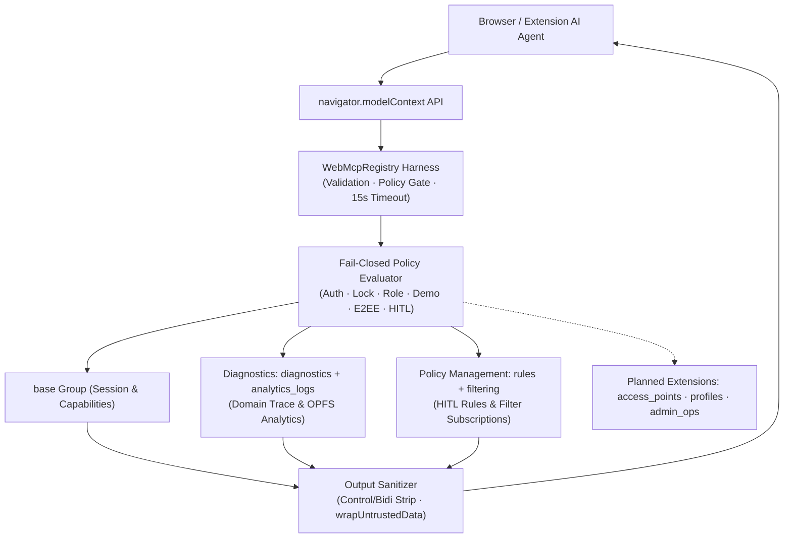

**DNS Worker** embeds a browser-native **WebMCP (`navigator.modelContext`)** foundation layer (`web/src/webmcp/`) inside its Web Dashboard. Once an authenticated user unlocks the console in a WebMCP-enabled browser, AI agents can call schema-validated modules cleanly without DOM scraping or standalone remote management credentials.

> **Browser Scope**: WebMCP relies on the experimental `navigator.modelContext` API (such as Chrome with `#enable-webmcp-testing` or Origin Trials). On unsupported browsers, DNS Worker skips tool registration silently with zero runtime errors.

---

## 1. Architecture & Execution Topology

Unlike headless server-side MCP servers, DNS Worker's WebMCP layer executes strictly within the active same-origin dashboard tab, synchronized with `useAuth` tokens and `IdleSessionLock`, while business capabilities plug in modularly through `registerGroup`:



---

## 2. Security Boundaries & Prompt-Injection Hardening

| Security Control | Implementation Mechanism | Enforcement Behavior |
| :--- | :--- | :--- |
| **Auth & Lock Screen Revocation** | `useWebMcpBridge` + `IdleSessionLock` (`dns_worker_lock_changed` / `session_paused`) | Logging out or locking the session immediately calls `unregisterTool` + `clearContext`, and every `execute` call re-validates live runtime state. |
| **E2EE Key Gate** | `e2ee.getUserStatus()` + `e2ee.isUnlocked()` | When PQC E2EE is enabled and private keys are locked, log and analytics tools fail with `E2EE_LOCKED` instead of returning ciphertext or empty lists. |
| **Demo Mode Write Guard** | Live `isDemoMode` check | Write tools are hidden from registration and rejected during invocation (`DEMO_MODE_READONLY`). |
| **Indirect Prompt Injection Defense** | `sanitizeUntrustedString`, `boundResultList`, `wrapUntrustedData` | Strips ASCII control characters and Unicode bidi overrides (such as `\u202E`) from domains, reasons, and URLs, caps arrays (max 50), and wraps external telemetry with a data-only notice. |
| **Secret Exclusion** | Explicit field allowlisting | Never exposes JWT access tokens, `profile_key` routing secrets, WebAuthn credentials, or E2EE private keys. |
| **Non-Redirecting Requests** | `profileFetch(..., redirectOn404 = false)` | HTTP `404` responses return structured errors instead of mutating `window.location.href = "/404"`. |

---

## 3. Base Session Group (`base`)

Always registered alongside the foundation layer so agents can inspect active permissions safely:

| Tool Name | Purpose | Arguments |
| :--- | :--- | :--- |
| `dnsworker_get_session_context` | Returns sanitized dashboard metadata (`deploymentMode`, `isDemoMode`, `userRole`, `activeProfileId`, E2EE enabled/unlocked flags). | None |
| `dnsworker_list_capabilities` | Lists active WebMCP capability groups and registered tool names in the current session. | None |

---

## 4. Response Envelope & Error Codes

Successful executions return `{"ok":true,"data":{...}}`; rejected calls set `isError: true` with `{"ok":false,"error":{"code":"...","message":"..."}}`:

| Error Code | Trigger Condition & Resolution |
| :--- | :--- |
| `WEBMCP_DISABLED` | Disabled via user preference (`dns_worker_webmcp_enabled`). |
| `AUTH_REQUIRED` | User is unauthenticated or lacks an in-memory access token. |
| `SESSION_LOCKED` | Console is locked by `IdleSessionLock`; unlock with user PIN first. |
| `FORBIDDEN_ROLE` | Caller lacks required `admin` role permissions. |
| `DEMO_MODE_READONLY` | Mutating action blocked under `DEMO_MODE=true`. |
| `E2EE_LOCKED` | PQC E2EE is enabled, but private keys have not been unlocked in memory. |
| `CONFIRMATION_DENIED` | Write action rejected or cancelled during human-in-the-loop prompt. |
| `INVALID_INPUT` | Input failed hostname, type, range, or schema validation. |
| `EXECUTION_TIMEOUT` | Execution exceeded the `15000ms` timeout budget. |
| `INTERNAL_ERROR` | Backend request error or local worker exception. |

---

## 5. Sub-Chapters & Capability Roadmap

DNS Worker organizes WebMCP business modules cleanly by workflow and risk tier:

- **Available — [Read-Only Diagnostics & Analytics](/DNS-Worker/mcp/diagnostics/)**: Includes `diagnostics` (domain blocking trace, per-list Bloom check, network probe) and `analytics_logs` (OPFS local log query, summary analytics, log detail, and Profile summary).
- **Available — [Rules & Filter Subscriptions](/DNS-Worker/mcp/rules-filtering/)**: Adds custom rules CRUD (`rules`) and external/user filter subscription toggling/sync (`filtering`), gated by `access: 'write'` human confirmation, Account toggle UI, and live view invalidation.
- **Planned — Device & Operations Management**: Access Point Profile binding (`access_points`), Profile settings tuning (`profiles`), and read-only admin diagnostics (`admin_ops`).
- **Permanently Excluded**: Password/MFA/Passkey mutations, E2EE key unwrapping/rotation exports, user deletion, database snapshot restore, Serverfull restarts, and Access Point token rotation (`rotateAccessPointToken`).

---

## 6. Extending with Additional Tool Groups

```typescript
import { defineWebMcpTool, webMcpRegistry } from '@/webmcp';

const exampleTools = [
  defineWebMcpTool({
    name: 'dnsworker_example_tool',
    description: 'Example read-only diagnostic tool',
    inputSchema: { type: 'object', properties: {}, additionalProperties: false },
    policy: { access: 'read', requiresAuth: true, requiresUnlocked: true },
    execute: async (_input, { runtimeState }) => ({
      activeProfileId: runtimeState.activeProfileId,
    }),
  }),
];

webMcpRegistry.registerGroup('example', exampleTools);
```
