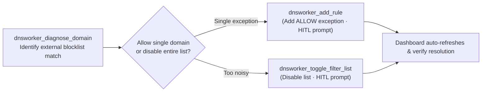

**DNS Worker** exposes policy-tuning capabilities via two modular WebMCP groups — **`rules`** and **`filtering`** — totaling **12 tools** (3 read-only inspection tools and 9 human-in-the-loop write tools). Every mutating tool enforces `access: 'write'` confirmation, disappears automatically in Demo Mode (`DEMO_MODE=true`), and broadcasts UI invalidation events so open dashboard views reflect changes immediately.

> **Default Profile Resolution**: Tools accepting an optional `profileId` automatically fall back to the active dashboard `activeProfileId` when omitted.

---

## 1. Write Safety Controls & UI Auto-Sync

To protect DNS availability and prevent unintended agent side effects, rule and subscription mutations enforce three dedicated safeguards over the WebMCP security core:

1. **Human-in-the-Loop Confirmation (HITL)**: Mutating calls prompt the user via `client.requestUserInteraction` (with explicit action summaries including patterns, rule counts, or target URLs) and fail closed with `CONFIRMATION_DENIED` when declined or running headlessly.
2. **Domain & URL Input Guardrails**:
   - Bare catch-all patterns such as `*`, `*.*`, and `.` are rejected by rule validators.
   - `REDIRECT` rules must include at least one non-empty record payload (`v_a`, `v_aaaa`, `v_cname`, or `v_txt`).
   - Subscription additions only allow `http://` or `https://` URLs up to `1024` characters without whitespace.
   - Batch operations (`dnsworker_add_rules_bulk`, `dnsworker_toggle_rules_bulk`, `dnsworker_delete_rules`) are capped at `50` items per invocation.
3. **Live Dashboard Synchronization**: Successful rule or subscription writes emit `dns_worker_webmcp_data_changed` scoped to `rules`, `filtering`, or `user_lists`, triggering immediate refreshes in open Rules, Filtering, and Account views without full-page reloads.

---

## 2. Custom Rules Tools (`rules`)

| Tool Name | Access | Purpose |
| :--- | :--- | :--- |
| `dnsworker_list_rules` | Read | Lists custom `ALLOW`, `BLOCK`, and `REDIRECT` rules for a Profile with optional `type`, `enabled`, `search`, and `limit` (1–50) filters. |
| `dnsworker_add_rule` | Write (HITL) | Creates one custom rule (`type` and `pattern` required; optional `include_subdomains`, `enabled`, and redirect values). |
| `dnsworker_add_rules_bulk` | Write (HITL) | Adds up to `50` validated custom rules in a single batch API call. |
| `dnsworker_update_rule` | Write (HITL) | Fetches the existing rule by `id`, merges updated fields cleanly without dropping untouched redirect targets, and saves the update. |
| `dnsworker_toggle_rules_bulk` | Write (HITL) | Enables or disables up to `50` custom rules by ID without deleting them. |
| `dnsworker_delete_rules` | Destructive (HITL) | Permanently deletes up to `50` custom rules by ID (`destructiveHint: true`). |

---

## 3. Filter Subscriptions & Sync Tools (`filtering`)

| Tool Name | Access | Purpose |
| :--- | :--- | :--- |
| `dnsworker_list_filter_subscriptions` | Read | Lists Profile-scoped, account user-level, and system-distributed subscriptions alongside rule stats and sanitized sync errors. |
| `dnsworker_list_preset_filters` | Read | Returns curated preset filter list recommendations configured on the DNS Worker server. |
| `dnsworker_get_sync_status` | Read | Reports real-time list sync and Bloom rebuild progress (`syncing`, `stage`, `percent`) for a Profile. |
| `dnsworker_toggle_filter_list` | Write (HITL) | Enables or disables a list by `listId` at either `profile` scope (including per-profile overrides) or `user` account scope. |
| `dnsworker_subscribe_filter_list` | Write (HITL) | Subscribes a Profile or account-level filter set to a validated HTTP(S) filter list URL. |
| `dnsworker_sync_filter_lists` | Write (HITL) | Starts an asynchronous single-list (`listId`) or full-Profile filter sync task; agents should poll `dnsworker_get_sync_status` for completion. |

---

## 4. Browser Toggle & Active Tool Inspection

Inside **Account Settings -> WebMCP Browser AI Interface**, users can inspect browser support (`navigator.modelContext`), toggle the local `dns_worker_webmcp_enabled` switch on or off at any time (immediately clearing active context registrations when disabled), and view the live list of tools active for the current session.

---

## 5. End-to-End Policy Tuning Flow

