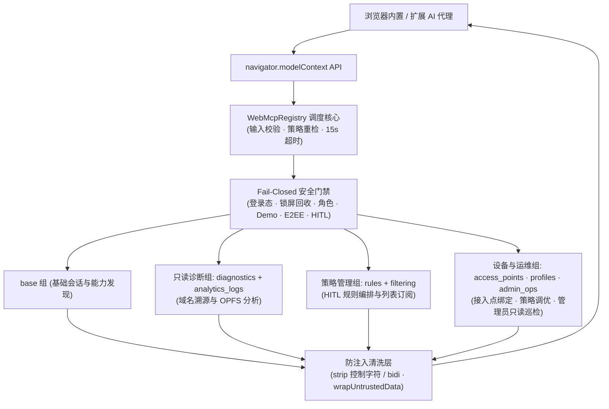

**DNS Worker** 在 Web 控制台中原生集成了基于 **WebMCP（`navigator.modelContext`）** 的浏览器工具基础层（`web/src/webmcp/`）。经授权的浏览器 AI 代理可在受控边界内通过 JSON Schema 调用模块化能力，无需脆弱的 DOM 点击抓取，也不必暴露独立无状态的远端管理密钥。

> **运行时适用范围**：WebMCP 属于浏览器的实验性客户端协议（如 Chrome 启用 `#enable-webmcp-testing` 或 Origin Trial）。当浏览器未提供 `navigator.modelContext` 时，DNS Worker 会静默跳过注册并保证控制台零报错运行。

---

## 1. 基础架构与调用拓扑

与服务端无状态 MCP 不同，DNS Worker WebMCP 运行在同源已登录控制台标签页内，直接受 `useAuth` 令牌与 `IdleSessionLock` 锁屏状态约束，并将各业务功能按分组（`registerGroup`）模块化挂载：



---

## 2. 安全边界与防提示词注入

| 安全机制 | 实现位置 | 行为约束 |
| :--- | :--- | :--- |
| **登录与锁屏同步回收** | `useWebMcpBridge` + `IdleSessionLock`（`dns_worker_lock_changed` / `session_paused`） | 登出或进入锁屏状态时立即调用 `unregisterTool` 与 `clearContext` 注销全部工具，并在 `execute` 入口复核以阻断旧闭包重放。 |
| **E2EE 解锁前置检查** | `e2ee.getUserStatus()` + `e2ee.isUnlocked()` | 启用后量子（PQC）E2EE 但私钥未解锁时，依赖明文日志的工具直接返回 `E2EE_LOCKED`。 |
| **Demo 模式写保护** | 检查 `isDemoMode` | 演示环境下屏蔽写操作工具注册并在执行期拦截（`DEMO_MODE_READONLY`）。 |
| **防间接提示词注入** | `sanitizeUntrustedString`、`boundResultList`、`wrapUntrustedData` | 剥离外部域名/报错文本中的 ASCII 控制字符与 Unicode 双向覆写字符（如 `\u202E`），限制列表长度（上限 50 条）并标记仅作数据消费。 |
| **凭据最小暴露** | 字段投影过滤 | 绝不返回 JWT 访问令牌、`profile_key` 路由私钥、WebAuthn 凭据或 E2EE 主私钥材料。 |
| **无重定向副作用** | `profileFetch(..., redirectOn404 = false)` | API 遇到 HTTP `404` 时返回结构化 JSON 错误，避免跳转 `/404` 中断代理上下文。 |

---

## 3. 基础诊断组（`base`）

以下两个基础工具随架构底座默认启用，用于确认当前 WebMCP 连接与激活权限边界：

| 工具名称 | 说明 | 参数 |
| :--- | :--- | :--- |
| `dnsworker_get_session_context` | 返回脱敏会话上下文（`deploymentMode`、`isDemoMode`、`userRole`、`activeProfileId`、E2EE 启用与解锁状态）。 | 无 |
| `dnsworker_list_capabilities` | 列出当前会话下实际已激活注册的 WebMCP 分组与工具清单。 | 无 |

---

## 4. 统一响应与错误码规范

成功响应固定返回 `{"ok":true,"data":{...}}`；失败时设置 `isError: true` 并返回 `{"ok":false,"error":{"code":"...","message":"..."}}`：

| 错误码 | 触发原因与处置建议 |
| :--- | :--- |
| `WEBMCP_DISABLED` | 用户已在本地偏好（`dns_worker_webmcp_enabled`）禁用 WebMCP。 |
| `AUTH_REQUIRED` | 当前未登录或缺乏有效内存 Access Token。 |
| `SESSION_LOCKED` | 控制台处于 PIN 锁屏状态，需先由用户解锁。 |
| `FORBIDDEN_ROLE` | 调用工具超出当前账号角色（如需要 `admin`）。 |
| `DEMO_MODE_READONLY` | 演示模式禁止写操作。 |
| `E2EE_LOCKED` | 已开启 PQC E2EE 但主私钥尚未解锁，需先完成 Passkey 或恢复密钥验证。 |
| `CONFIRMATION_DENIED` | 写操作在人机二次确认（HITL）环节被取消或拒绝。 |
| `INVALID_INPUT` | 参数未通过域名/类型/数值区间或 JSON Schema 校验。 |
| `EXECUTION_TIMEOUT` | 单次工具调用超过默认 `15000ms` 超时阈值。 |
| `INTERNAL_ERROR` | 后端请求失败或本地 Worker 异常。 |

---

## 5. 功能子章节与模块规划

DNS Worker 的 WebMCP 能力按风险等级与业务闭环分阶段交付：

- **已上线 — [只读诊断与分析](/DNS-Worker/zh-cn/mcp/diagnostics/)**：涵盖 `diagnostics`（域名拦截溯源、单列表检测、网络探测）与 `analytics_logs`（OPFS 本地日志检索、聚合统计、日志详情与 Profile 概览）。
- **已上线 — [规则编排与列表订阅管理](/DNS-Worker/zh-cn/mcp/rules-filtering/)**：涵盖自定义规则增删改（`rules`）、外部与账号级订阅启停/同步（`filtering`）、HITL 人机确认门禁、Account 设置页开关与 UI 状态自动刷新。
- **已上线 — [设备接入点、配置策略与运维观测](/DNS-Worker/zh-cn/mcp/access-ops/)**：涵盖设备接入点 Profile 绑定切换与创建（`access_points`）、Profile DNS 策略与暂停过滤调优（`profiles`）以及受 `admin` 角色隔离保护的只读运维巡检（`admin_ops`）。
- **永久排除边界**：密码/MFA/Passkey 变更、E2EE 密钥导出/轮换、用户删除、数据库快照恢复、服务重启及接入点令牌轮换（`rotateAccessPointToken`）等高危操作不接入自动化 AI 工具。

---

## 6. 开发者模块接入示例

新增业务模块通过 `defineWebMcpTool` 与 `webMcpRegistry.registerGroup` 挂载即可自动继承全套安全策略：

```typescript
import { defineWebMcpTool, webMcpRegistry } from '@/webmcp';

const exampleTools = [
  defineWebMcpTool({
    name: 'dnsworker_example_tool',
    description: '示例工具描述',
    inputSchema: { type: 'object', properties: {}, additionalProperties: false },
    policy: { access: 'read', requiresAuth: true, requiresUnlocked: true },
    execute: async (_input, { runtimeState }) => ({
      activeProfileId: runtimeState.activeProfileId,
    }),
  }),
];

webMcpRegistry.registerGroup('example', exampleTools);
```
