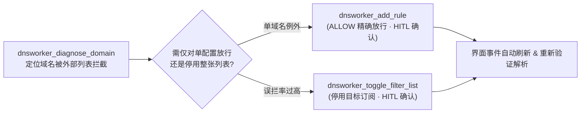

**DNS Worker** 通过 **`rules`（自定义规则编排）** 与 **`filtering`（外部过滤列表订阅与同步）** 两个模块开放可控写操作能力，共计 **12 个工具**（3 个只读工具 + 9 个受人机确认门禁保护的写操作工具）。所有写工具均默认强制触发 `access: 'write'` 人类二次确认（HITL）、在 `DEMO_MODE=true` 下自动隐藏与拒绝执行，并在变更完成后通过浏览器事件总线即时刷新已打开的前端视图。

> **默认边界提醒**：所有按 Profile 作用域执行的工具支持省略 `profileId`，未传入时默认使用控制台当前激活的 `activeProfileId`。

---

## 1. 安全写门禁与界面同步机制

由于规则与订阅操作会变更生效策略，系统在基础门禁之外补充了三项专门防护：

1. **人机二次确认（HITL）**：所有写工具必须经由 `client.requestUserInteraction` 配合用户交互弹窗放行；无交互环境或用户取消时严格返回 `CONFIRMATION_DENIED`。
2. **输入边界守卫**：
   - 自定义规则禁止写入 `*`、`*.*`、`.` 等全量兜底通配符，防止意外放行或阻断全部域名。
   - `REDIRECT` 类型规则强制至少包含一项记录目标（`v_a`、`v_aaaa`、`v_cname` 或 `v_txt`）。
   - 外部订阅 URL 仅接受 `http://` 或 `https://` 协议且限制长度不超过 `1024` 字符。
   - 单次批量新增、启停或删除自定义规则上限均限制为 `50` 条。
3. **视图状态自动刷新**：任意规则或订阅写工具执行成功后，都会触发 `dns_worker_webmcp_data_changed` 事件（携带 `scope` 与 `profileId`），使已打开的规则管理页、过滤列表页与账号级列表卡片自动同步最新后端状态，无需刷新整个浏览器页面。

---

## 2. 自定义规则工具（`rules`）

| 工具名称 | 访问属性 | 说明 |
| :--- | :--- | :--- |
| `dnsworker_list_rules` | 只读 | 查询当前 Profile 下的 `ALLOW` / `BLOCK` / `REDIRECT` 自定义规则，支持按 `type`、`enabled`、`search` 关键词与 `limit`（1–50）筛选。 |
| `dnsworker_add_rule` | 写入 (HITL) | 新增单条自定义规则（`type`、`pattern` 必填，可选 `include_subdomains`、`enabled` 及重定向目标字段）。 |
| `dnsworker_add_rules_bulk` | 写入 (HITL) | 单次原子批量新增最多 `50` 条自定义规则。 |
| `dnsworker_update_rule` | 写入 (HITL) | 根据规则正整数 `id` 执行增量合并更新（先读取原规则再合并修改字段，避免遗漏未修改的重定向值）。 |
| `dnsworker_toggle_rules_bulk` | 写入 (HITL) | 批量启用或停用最多 `50` 条指定 ID 列表的自定义规则，不删除历史记录。 |
| `dnsworker_delete_rules` | 删除 (HITL / `destructiveHint`) | 批量永久删除最多 `50` 条自定义规则，确认框与描述符均带有破坏性提示标识。 |

---

## 3. 过滤列表与同步工具（`filtering`）

| 工具名称 | 访问属性 | 说明 |
| :--- | :--- | :--- |
| `dnsworker_list_filter_subscriptions` | 只读 | 读取 Profile 级、账号级（`user`）及系统下发（`system`）的外部过滤列表订阅、规则统计摘要及最近同步错误信息。 |
| `dnsworker_list_preset_filters` | 只读 | 获取服务端配置的推荐预设拦截列表清单（标签、订阅地址、分类与描述）。 |
| `dnsworker_get_sync_status` | 只读 | 查询指定 Profile 的后台列表下载与布隆过滤器合并进度（`syncing`、`stage`、`percent`）。 |
| `dnsworker_toggle_filter_list` | 写入 (HITL) | 按 `scope`（`profile` 或 `user`）启用或停用指定 `listId` 订阅，触发后端重编布隆过滤器。 |
| `dnsworker_subscribe_filter_list` | 写入 (HITL) | 向目标 Profile 或账号全局列表新增经校验的 HTTP(S) 外部规则订阅源。 |
| `dnsworker_sync_filter_lists` | 写入 (HITL) | 异步发起单个 `listId` 或当前 Profile 全量启用列表的同步拉取任务；返回后代理应调用 `dnsworker_get_sync_status` 轮询进度。 |

---

## 4. 浏览器偏好开关与状态检查

用户可在控制台 **账号设置（Account） -> WebMCP 浏览器 AI 接口** 卡片中随时：

- 查看当前浏览器是否暴露 `navigator.modelContext` 实验接口；
- 一键开启或关闭本地 `dns_worker_webmcp_enabled` 偏好开关（关闭后立即注销工具并在执行层返回 `WEBMCP_DISABLED`）；
- 查看当前会话权限边界下已实际激活的工具清单。

---

## 5. 典型调优协作流程

