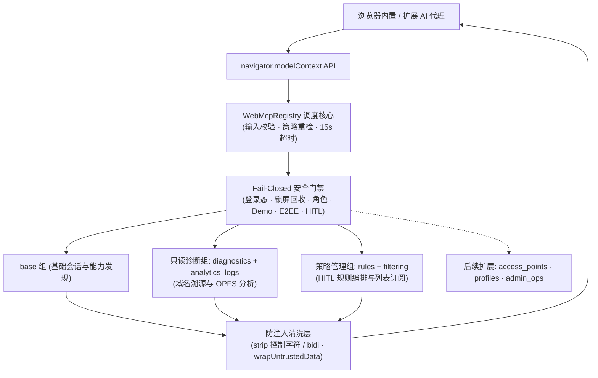

**DNS Worker** 在 Web 控制台中原生集成了基於 **WebMCP（`navigator.modelContext`）** 的瀏覽器工具基礎層（`web/src/webmcp/`）。經授權的瀏覽器 AI 代理可在受控邊界內通過 JSON Schema 呼叫模組化能力，無需脆弱的 DOM 點選抓取，也不必暴露獨立無狀態的遠端管理金鑰。

> **執行時適用範圍**：WebMCP 屬於瀏覽器的實驗性客戶端協議（如 Chrome 啟用 `#enable-webmcp-testing` 或 Origin Trial）。當瀏覽器未提供 `navigator.modelContext` 時，DNS Worker 會靜默跳過註冊並保證控制台零報錯執行。

---

## 1. 基礎架構與呼叫拓撲

與服務端無狀態 MCP 不同，DNS Worker WebMCP 執行在同源已登入控制台標籤頁內，直接受 `useAuth` 令牌與 `IdleSessionLock` 鎖屏狀態約束，並將各業務功能按分組（`registerGroup`）模組化掛載：



---

## 2. 安全邊界與防提示詞注入

| 安全機制 | 實現位置 | 行為約束 |
| :--- | :--- | :--- |
| **登入與鎖屏同步回收** | `useWebMcpBridge` + `IdleSessionLock`（`dns_worker_lock_changed` / `session_paused`） | 登出或進入鎖屏狀態時立即呼叫 `unregisterTool` 與 `clearContext` 登出全部工具，並在 `execute` 入口複核以阻斷舊閉包重放。 |
| **E2EE 解鎖前置檢查** | `e2ee.getUserStatus()` + `e2ee.isUnlocked()` | 啟用後量子（PQC）E2EE 但私鑰未解鎖時，依賴明文日誌的工具直接返回 `E2EE_LOCKED`。 |
| **Demo 模式防寫** | 檢查 `isDemoMode` | 演示環境下遮蔽寫操作工具註冊並在執行期攔截（`DEMO_MODE_READONLY`）。 |
| **防間接提示詞注入** | `sanitizeUntrustedString`、`boundResultList`、`wrapUntrustedData` | 剝離外部域名/報錯文本中的 ASCII 控制字元與 Unicode 雙向覆寫字元（如 `\u202E`），限制列表長度（上限 50 條）並標記僅作資料消費。 |
| **憑據最小暴露** | 欄位投影過濾 | 絕不返回 JWT 訪問令牌、`profile_key` 路由私鑰、WebAuthn 憑據或 E2EE 主私鑰材料。 |
| **無重定向副作用** | `profileFetch(..., redirectOn404 = false)` | API 遇到 HTTP `404` 時返回結構化 JSON 錯誤，避免跳轉 `/404` 中斷代理上下文。 |

---

## 3. 基礎診斷組（`base`）

以下兩個基礎工具隨架構底座預設啟用，用於確認當前 WebMCP 連線與啟用許可權邊界：

| 工具名稱 | 說明 | 引數 |
| :--- | :--- | :--- |
| `dnsworker_get_session_context` | 返回脫敏會話上下文（`deploymentMode`、`isDemoMode`、`userRole`、`activeProfileId`、E2EE 啟用與解鎖狀態）。 | 無 |
| `dnsworker_list_capabilities` | 列出當前會話下實際已啟用註冊的 WebMCP 分組與工具清單。 | 無 |

---

## 4. 統一響應與錯誤碼規範

成功響應固定返回 `{"ok":true,"data":{...}}`；失敗時設定 `isError: true` 並返回 `{"ok":false,"error":{"code":"...","message":"..."}}`：

| 錯誤碼 | 觸發原因與處置建議 |
| :--- | :--- |
| `WEBMCP_DISABLED` | 使用者已在本地偏好（`dns_worker_webmcp_enabled`）停用 WebMCP。 |
| `AUTH_REQUIRED` | 當前未登入或缺乏有效記憶體 Access Token。 |
| `SESSION_LOCKED` | 控制台處於 PIN 鎖屏狀態，需先由使用者解鎖。 |
| `FORBIDDEN_ROLE` | 呼叫工具超出當前賬號角色（如需要 `admin`）。 |
| `DEMO_MODE_READONLY` | 演示模式禁止寫操作。 |
| `E2EE_LOCKED` | 已開啟 PQC E2EE 但主私鑰尚未解鎖，需先完成 Passkey 或恢復金鑰驗證。 |
| `CONFIRMATION_DENIED` | 寫操作在人機二次確認（HITL）環節被取消或拒絕。 |
| `INVALID_INPUT` | 引數未通過域名/型別/數值區間或 JSON Schema 校驗。 |
| `EXECUTION_TIMEOUT` | 單次工具呼叫超過預設 `15000ms` 超時閾值。 |
| `INTERNAL_ERROR` | 後端請求失敗或本地 Worker 異常。 |

---

## 5. 功能子章節與模組規劃

DNS Worker 的 WebMCP 能力按風險等級與業務閉環分階段交付：

- **已上線 — [只讀診斷與分析](/DNS-Worker/zh-tw/mcp/diagnostics/)**：涵蓋 `diagnostics`（域名攔截溯源、單列表檢測、網路探測）與 `analytics_logs`（OPFS 本地日誌檢索、聚合統計、日誌詳情與 Profile 概覽）。
- **已上線 — [規則編排與列表訂閱管理](/DNS-Worker/zh-tw/mcp/rules-filtering/)**：涵蓋自定義規則增刪改（`rules`）、外部與賬號級訂閱啟停/同步（`filtering`）、HITL 人機確認門禁、Account 設定頁開關與 UI 狀態自動重新整理。
- **規劃中 — 裝置與運維管理**：接入點 Profile 繫結切換（`access_points`）、Profile 策略修改（`profiles`）及管理員只讀觀測（`admin_ops`）。
- **永久排除邊界**：密碼/MFA/Passkey 變更、E2EE 金鑰匯出/輪換、使用者刪除、資料庫快照恢復、服務重啟及接入點令牌輪換（`rotateAccessPointToken`）等高危操作不接入自動化 AI 工具。

---

## 6. 開發者模組接入示例

新增業務模組通過 `defineWebMcpTool` 與 `webMcpRegistry.registerGroup` 掛載即可自動繼承全套安全策略：

```typescript
import { defineWebMcpTool, webMcpRegistry } from '@/webmcp';

const exampleTools = [
  defineWebMcpTool({
    name: 'dnsworker_example_tool',
    description: '示例工具描述',
    inputSchema: { type: 'object', properties: {}, additionalProperties: false },
    policy: { access: 'read', requiresAuth: true, requiresUnlocked: true },
    execute: async (_input, { runtimeState }) => ({
      activeProfileId: runtimeState.activeProfileId,
    }),
  }),
];

webMcpRegistry.registerGroup('example', exampleTools);
```
