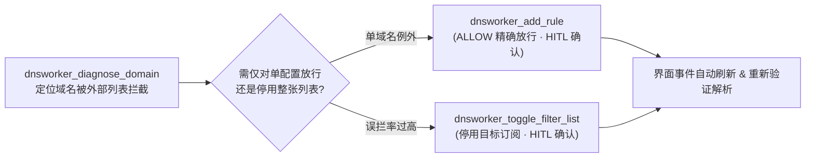

**DNS Worker** 通過 **`rules`（自定義規則編排）** 與 **`filtering`（外部過濾列表訂閱與同步）** 兩個模組開放可控寫操作能力，共計 **12 個工具**（3 個只讀工具 + 9 個受人機確認門禁保護的寫操作工具）。所有寫工具均預設強制觸發 `access: 'write'` 人類二次確認（HITL）、在 `DEMO_MODE=true` 下自動隱藏與拒絕執行，並在變更完成後通過瀏覽器事件匯流排即時重新整理已開啟的前端檢視。

> **預設邊界提醒**：所有按 Profile 作用域執行的工具支援省略 `profileId`，未傳入時預設使用控制台當前啟用的 `activeProfileId`。

---

## 1. 安全寫門禁與介面同步機制

由於規則與訂閱操作會變更生效策略，系統在基礎門禁之外補充了三項專門防護：

1. **人機二次確認（HITL）**：所有寫工具必須經由 `client.requestUserInteraction` 配合使用者互動彈窗放行；無互動環境或使用者取消時嚴格返回 `CONFIRMATION_DENIED`。
2. **輸入邊界守衛**：
   - 自定義規則禁止寫入 `*`、`*.*`、`.` 等全量兜底萬用字元，防止意外放行或阻斷全部域名。
   - `REDIRECT` 型別規則強制至少包含一項記錄目標（`v_a`、`v_aaaa`、`v_cname` 或 `v_txt`）。
   - 外部訂閱 URL 僅接受 `http://` 或 `https://` 協議且限制長度不超過 `1024` 字元。
   - 單次批次新增、啟停或刪除自定義規則上限均限制為 `50` 條。
3. **檢視狀態自動重新整理**：任意規則或訂閱寫工具執行成功後，都會觸發 `dns_worker_webmcp_data_changed` 事件（攜帶 `scope` 與 `profileId`），使已開啟的規則管理頁、過濾列表頁與賬號級列表卡片自動同步最新後端狀態，無需重新整理整個瀏覽器頁面。

---

## 2. 自定義規則工具（`rules`）

| 工具名稱 | 訪問屬性 | 說明 |
| :--- | :--- | :--- |
| `dnsworker_list_rules` | 只讀 | 查詢當前 Profile 下的 `ALLOW` / `BLOCK` / `REDIRECT` 自定義規則，支援按 `type`、`enabled`、`search` 關鍵詞與 `limit`（1–50）篩選。 |
| `dnsworker_add_rule` | 寫入 (HITL) | 新增單條自定義規則（`type`、`pattern` 必填，可選 `include_subdomains`、`enabled` 及重定向目標欄位）。 |
| `dnsworker_add_rules_bulk` | 寫入 (HITL) | 單次原子批次新增最多 `50` 條自定義規則。 |
| `dnsworker_update_rule` | 寫入 (HITL) | 根據規則正整數 `id` 執行增量合併更新（先讀取原規則再合併修改欄位，避免遺漏未修改的重定向值）。 |
| `dnsworker_toggle_rules_bulk` | 寫入 (HITL) | 批次啟用或停用最多 `50` 條指定 ID 列表的自定義規則，不刪除歷史記錄。 |
| `dnsworker_delete_rules` | 刪除 (HITL / `destructiveHint`) | 批次永久刪除最多 `50` 條自定義規則，確認框與描述符均帶有破壞性提示標識。 |

---

## 3. 過濾列表與同步工具（`filtering`）

| 工具名稱 | 訪問屬性 | 說明 |
| :--- | :--- | :--- |
| `dnsworker_list_filter_subscriptions` | 只讀 | 讀取 Profile 級、賬號級（`user`）及系統下發（`system`）的外部過濾列表訂閱、規則統計摘要及最近同步錯誤資訊。 |
| `dnsworker_list_preset_filters` | 只讀 | 獲取服務端配置的推薦預設攔截列表清單（標籤、訂閱地址、分類與描述）。 |
| `dnsworker_get_sync_status` | 只讀 | 查詢指定 Profile 的後臺列表下載與布隆過濾器合併進度（`syncing`、`stage`、`percent`）。 |
| `dnsworker_toggle_filter_list` | 寫入 (HITL) | 按 `scope`（`profile` 或 `user`）啟用或停用指定 `listId` 訂閱，觸發後端重編布隆過濾器。 |
| `dnsworker_subscribe_filter_list` | 寫入 (HITL) | 向目標 Profile 或賬號全域性列表新增經校驗的 HTTP(S) 外部規則訂閱源。 |
| `dnsworker_sync_filter_lists` | 寫入 (HITL) | 非同步發起單個 `listId` 或當前 Profile 全量啟用列表的同步拉取任務；返回後代理應呼叫 `dnsworker_get_sync_status` 輪詢進度。 |

---

## 4. 瀏覽器偏好開關與狀態檢查

使用者可在控制台 **賬號設定（Account） -> WebMCP 瀏覽器 AI 介面** 卡片中隨時：

- 檢視當前瀏覽器是否暴露 `navigator.modelContext` 實驗介面；
- 一鍵開啟或關閉本地 `dns_worker_webmcp_enabled` 偏好開關（關閉後立即登出工具並在執行層返回 `WEBMCP_DISABLED`）；
- 檢視當前會話許可權邊界下已實際啟用的工具清單。

---

## 5. 典型調優協作流程

